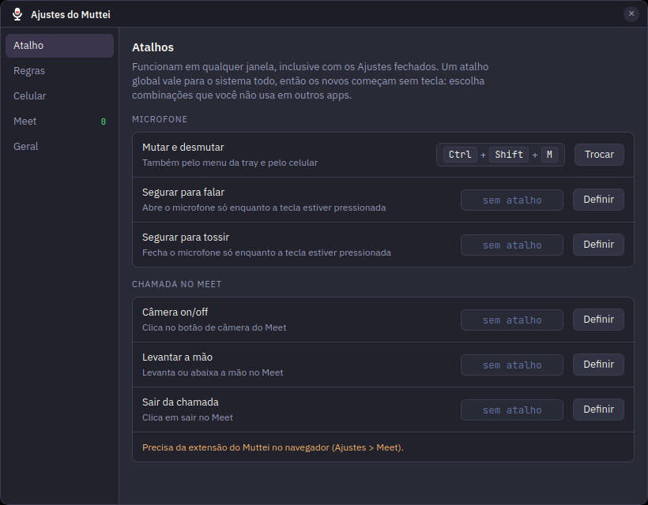
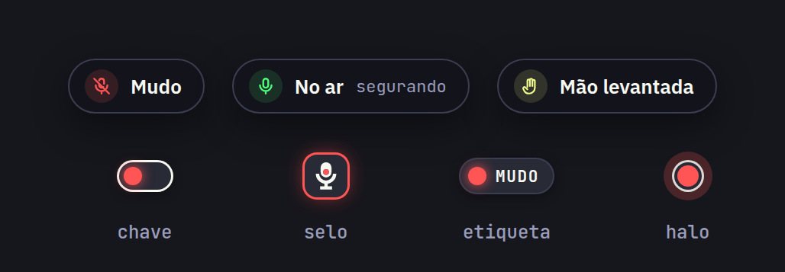
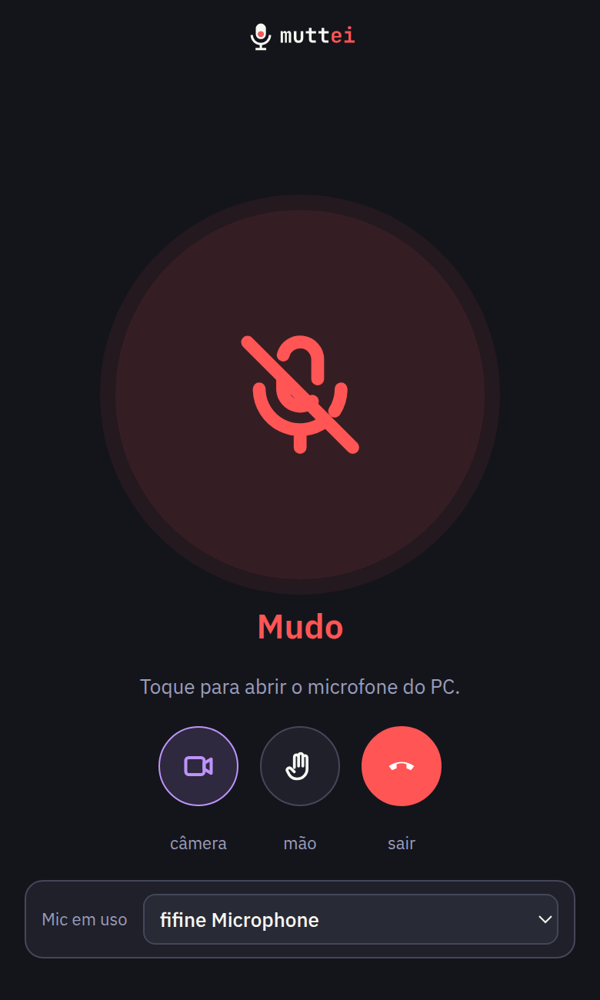

<p align="center">
  <picture>
    <source media="(prefers-color-scheme: dark)" srcset="brand/logo/horizontal-dark.svg">
    
  </picture>
</p>

<p align="center"><b>Seu microfone em um atalho, em qualquer chamada.</b></p>

<p align="center">
  
  
  
  
  
</p>

<p align="center">
  <a href="#instalar">Instalar</a> · <a href="#o-que-ele-faz">O que ele faz</a> · <a href="#perguntas">Perguntas</a>
</p>

<p align="center">
  
</p>

## A chamada não espera você achar o botão

- O cachorro late bem quando chega a sua vez de falar. O botão de mudo está numa aba do navegador, atrás da planilha.
- Você explica uma ideia por um minuto inteiro e só depois alguém avisa: "acho que você está no mudo".
- Na reunião seguinte é outro app, com o botão em outro canto e outro ícone.
- E fica a dúvida de sempre: o microfone está aberto ou fechado?

O microfone é do sistema, não do app da chamada. Então o botão também deveria ser do sistema.

## Como resolve

1. **Instale** o `.deb`. O Muttei fica na tray e abre com o sistema.
2. **Aperte `Ctrl+Shift+M`** em qualquer janela. Ele muta o microfone do PipeWire, ou seja, o de todos os apps ao mesmo tempo.
3. **Olhe para a tela.** Uma pílula confirma "Mudo" ou "No ar", e um indicador fica no canto enquanto o microfone estiver fechado.

## O que ele faz

### Um atalho para tudo
`Ctrl+Shift+M` funciona com o Meet, o Zoom, o Discord, o Slack, o navegador e o que mais usar o microfone, porque age no dispositivo e não no app. Nos Ajustes você troca a tecla e define atalhos opcionais para segurar para falar e segurar para tossir. Os atalhos novos começam sem tecla. Por padrão o Muttei muta o microfone padrão do sistema. Em Ajustes > Geral dá para fixar outro, como o headset. Se ele for desconectado, o app volta para o padrão até o microfone voltar.

<p align="center"></p>

### Você sempre sabe se está no ar
A pílula aparece em todos os monitores a cada mudança. Enquanto o microfone estiver fechado, um indicador vermelho fica fixo no canto, em quatro estilos à escolha: chave, selo, etiqueta e halo. O ícone na tray também muda de cor.

<p align="center"></p>

### Regras que mutam por você
O Muttei muta ao travar a tela, ao entrar numa chamada do Meet e quando abre um app da sua lista, por exemplo o `zoom`. As regras só fecham o microfone, nunca abrem.

### O celular vira o botão
Se você levantou da mesa, abra a página do Muttei no celular, na mesma rede Wi-Fi. Não precisa instalar nada. O pareamento é por QR e por um código de 4 dígitos, e cada aparelho pode ser revogado nos Ajustes. Com uma chamada do Meet aberta, aparecem também os botões de câmera, mão e sair.

<p align="center"></p>

### Google Meet de verdade
Com a extensão em [`extension/`](extension/), o ícone de microfone do Meet acompanha o estado do Muttei. A extensão também executa câmera, levantar a mão e sair da chamada, pelo atalho ou pelo celular.

## Privacidade

- **Não grava nem escuta.** O Muttei só liga e desliga o mute da entrada padrão com `wpctl`. Ele nunca abre o áudio.
- **Tudo fica no seu PC.** Não há conta, servidor nem telemetria.
- **Celular:** só funciona na rede local, depois do pareamento. Cada mensagem é conferida com o token do aparelho.
- **Extensão do Meet:** fala só com `127.0.0.1` e só é aceita se vier de uma extensão do navegador.

## Perguntas

<details>
<summary><b>O GNOME já não tem uma tecla de mudo?</b></summary>

Tem a tecla de mudo do microfone, que mostra um aviso por um segundo e some. O Muttei soma a isso o indicador fixo enquanto o microfone estiver fechado, a pílula em todos os monitores, segurar para falar ou para tossir, as regras, o celular e o Meet.
</details>

<details>
<summary><b>Funciona com qualquer app de chamada?</b></summary>

Sim. O mute é aplicado no PipeWire, então vale para todos os apps que usam a entrada padrão. Só o Meet tem integração extra, porque o ícone dele precisa acompanhar o estado.
</details>

<details>
<summary><b>O som de confirmação vaza para a chamada?</b></summary>

O som toca na saída, com `pw-play`, e não entra no microfone. Se você usar alto-falante com o microfone aberto, ele pode captar o som como captaria qualquer outro barulho. Dá para desligar o som em Ajustes > Geral.
</details>

<details>
<summary><b>Funciona no Wayland?</b></summary>

Sim. No Wayland o app roda pelo XWayland, que mantém a pílula e o indicador no lugar. Os atalhos dependem da sessão:

| Sessão | Atalhos | Segurar para falar/tossir |
|---|---|---|
| X11 | grab do X11 | sim |
| Wayland, GNOME 48+ ou KDE | portal `GlobalShortcuts` (o sistema pede aprovação) | sim |
| Wayland, GNOME 46/47 | atalhos personalizados do GNOME que chamam `muttei --action <ação>` | não: o GNOME não informa quando a tecla é solta |

Para forçar um backend, use `MUTTEI_SHORTCUTS=x11|portal|gnome`.
</details>

<details>
<summary><b>Precisa de internet?</b></summary>

Não. As fontes, a página do celular e a extensão funcionam sem internet.
</details>

## Instalar

O Muttei é feito para Ubuntu 22.04 ou mais novo e outras distros com GNOME e PipeWire.

Baixe o `.deb` da [última versão](../../releases/latest) e instale:

```sh
sudo apt install ./Muttei_*_amd64.deb
```

O `.deb` já puxa as dependências de execução: `wireplumber`, `pipewire-bin`, `libglib2.0-bin` e `sound-theme-freedesktop`.

**Para compilar:**
```sh
sudo apt install libwebkit2gtk-4.1-dev libayatana-appindicator3-dev librsvg2-dev libxdo-dev libssl-dev build-essential pkg-config
cargo install tauri-cli --version '^2'
./scripts/package-deb.sh
sudo apt install ./src-tauri/target/release/bundle/deb/Muttei_0.1.0_amd64.deb
```

**Para desenvolver:**
```sh
cd src-tauri && cargo tauri dev
```

**Para a extensão do Meet:**
1. Abra `chrome://extensions` e ligue o modo desenvolvedor.
2. Clique em "Carregar sem compactação" e escolha a pasta `extension/`.
3. A primeira extensão que se conecta é aprovada sozinha. As outras precisam ser pareadas em Ajustes > Meet.

**Para publicar uma versão:** suba a versão em `src-tauri/tauri.conf.json` e envie uma tag `v*`, por exemplo `git tag v0.2.0 && git push --tags`. O workflow `Release` roda os testes, gera o `.deb` e cria a release com ele.
